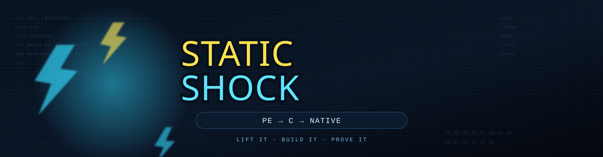
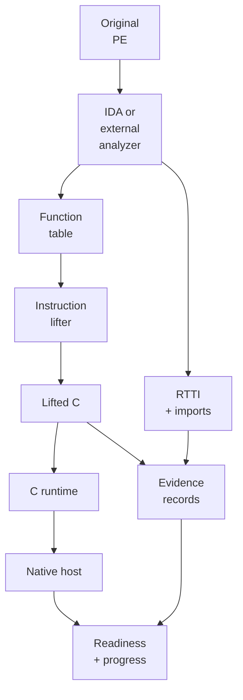

# Static recompilation pipeline for PE programs

<p align="center">
  
</p>

<p align="center">
  <b>Lift a Windows PE into C. Build a native host. Prove the behaviour with evidence.</b><br>
  <sub>A template and toolkit for reverse engineers, porters and agents who care about correctness.</sub>
</p>

<p align="center">
  <a href="https://www.python.org/"></a>
  <a href="https://en.wikipedia.org/wiki/C11_(C_standard_revision)"></a>
  <a href="https://www.microsoft.com/windows"></a>
  
  
  <a href="LICENSE"></a>
  
</p>

StaticShock is not a one-click decompiler. It is the structure around a correct lift: analysis
export, function table, instruction-by-instruction C translation, a runtime that preserves the
guest machine, a Win32 import bridge, and a verification loop that records what is actually known.

The lifted C is the program. The host maps the original image's data at its own addresses, keeps
the guest registers in globals, and dispatches imports through a sentinel table. No emulator and no
original machine code are used at run time.

> **This is the template repository, not a target workspace.** Copy it to a new folder and run the
> pipeline there. Agents must work from the copy. Do not put an original executable, lifted source,
> IDA exports, game data or builds in this tree. In the copy, delete this README and write the
> target's own: what the program is, how to build and run it, and what is still unknown.

> **x64 backend: WIP.** PE32+ parsing, architecture-aware config, manifest and `doctor` checks are
> in. The x64 lifter, runtime ABI and build layout are next. The shipped backend remains x86-32.

## What you get

| | |
|---|---|
| **Lifter** | One x86 instruction to one or more C statements. Flags, x87, SSE, string ops, jump tables and indirect calls. Unsupported instructions fail loudly. |
| **Runtime** | Guest registers and memory, image mapping, import dispatch, threads, TLS, boot, crash reports, FPU helpers. |
| **Import bridge** | stdcall, cdecl and thiscall, callbacks, guest pointers, file paths, x87 `ST(0)` returns and window presentation. |
| **Build** | 32-bit MinGW host with explicit `.guest`/`.tail`/`.text` layout, pre-CRT reservation, stack/heap reserves and a linker map. |
| **WebAssembly** | wasm32 host layer: guest image in linear memory, sentinel dispatch, x87 specials, browser input and a chunked preload shell. Imports are per-target and fail loudly when missing. |
| **Analysis** | IDA export with pseudocode chunks, an external-analyzer backend with per-function asm/pseudocode, and `src`-aligned x86 listings in `asm/`. |
| **RTTI** | MSVC type descriptors, complete object locators, vtables, base classes and positional vfunc slots. |
| **Evidence** | Target manifest, machine-readable inventory, claim schema, unknowns registry and a fail-closed readiness report. |
| **Workflow** | Per-function work status and a self-contained HTML progress dashboard. |
| **Docs** | 22 focused guides: model, lifting, ABI, host, build, debugging, porting, WASM, x86-64, naming, evidence, verification. |

## Pipeline



## Quick start

1. Copy this repository to a new folder and open `project.toml`.
2. Set `project.exe`, `project.image_base`, `project.entry`, `project.code_lo`, `project.code_hi`
   and `project.image_end` from the PE headers.
3. Export the analysis.

   With IDA:

   ```sh
   idat.exe -A -S"pipeline/ida_export.py" -Lida/ida.log path/to/original.exe
   ```

   Or with an external native analyzer:

   ```sh
   python static_shock.py analyze --provider ghidra
   ```

4. Build the tables and lift:

   ```sh
   python static_shock.py functions
   python static_shock.py rtti
   python static_shock.py lift
   python static_shock.py asm
   python static_shock.py api
   python static_shock.py build
   ```

5. Record and check the state:

   ```sh
   python static_shock.py manifest
   python static_shock.py inventory
   python static_shock.py verify
   python static_shock.py readiness
   python static_shock.py progress
   ```

6. Run `bin/<host_exe>` from the folder that holds the data. The host defaults to its own folder
   and then to `<exe folder>/data`.

7. Build the wasm target (needs Emscripten; `[wasm].emcc` or `SS_EMCC`):

   ```sh
   python build_wasm.py --preload-data
   python web/serve.py bin/wasm 8080
   ```

   The shell is WIP until the target implements its imports in `runtime/wasm/imports.c`.

## Analysis backends

| Backend | When to use it | Notes |
|---|---|---|
| IDA + Hex-Rays | You have IDA and want the most complete function table. | Default. Exports functions, imports, segments, strings and pseudocode chunks. |
| External native analyzer | You already have a Ghidra/IDA/Hopper setup and want provider evidence. | `pipeline/analyzer_export.py` expects a procedure search that returns `{address, value}` evidence. Adapt `call()` for another CLI. |
| PE only | You only need imports or a quick check. | `pe_image.py` reads the section table and import directory directly. Function discovery still needs an analysis backend. |

The lifter decodes the instructions itself from the PE bytes; the analysis backend supplies the
function starts and names.

## Proof, not vibes

A green build is not correctness. The repository keeps four records:

- `recomp/data/target.json` - target identity: SHA-256, image base, entry, sections, imports, tool
  versions. Verifiable.
- `recomp/data/inventory.json` - every function with size, category, name confidence, RTTI names,
  evidence kind and unsupported-instruction status.
- `recomp/data/unknowns.json` - open questions with supporting and contradicting evidence. A
  resolution requires evidence.
- `recomp/data/readiness.json` - fail-closed checks. `unknown`, `unsupported` and `skipped` never
  aggregate to `pass`.

RTTI names are treated as slot evidence, not semantic method names. Unsupported instructions are
listed, never stubbed.

## Layout

| Path | Purpose |
|---|---|
| `project.toml` | Every target-specific value: executable, image base, entry, ranges, linker layout, imports, analyzer. |
| `pipeline/` | Analysis export, function table, RTTI, lifter, API table, manifest, inventory, readiness, progress. |
| `runtime/` | Registers, FPU, guest memory, import dispatch, crash reports, threads, boot. |
| `runtime/wasm/` | WebAssembly host: linear-memory services, sentinel dispatch, special imports, input queue and the per-target import hook. |
| `web/` | Browser shell: canvas, input mapping, chunked data preload and a development server. |
| `docs/` | The full workflow and the failure modes. Start with `docs/00-overview.md` and `docs/11-porting-checklist.md`. |
| `schemas/` | Evidence record schema. |
| `src/`, `ida/`, `recomp/data/`, `analysis/`, `bin/`, `build/`, `reports/` | Working folders; each has a README explaining what belongs there. |
| `tests/` | Unit, differential and replay tests. No original binary is committed. |

## Status and limits

- The shipped backend is x86-32.
- The x64 backend is WIP: PE32+ parsing, architecture-aware configuration, manifest and `doctor`
  checks are in. The x64 lifter, runtime ABI and build layout are not; `build.py` refuses
  `arch = "x64"` until they exist. See `docs/14-x64.md`.
- The template ships no original executable, game data, assets or keys.
- The lifter is conservative: an instruction it does not model stops the program with an address.
- SEH is not dispatched; a fault is a host crash with a guest register dump.
- `lock`-prefixed instructions are serialized by a global guest lock, not truly atomic.
- Native Windows x86-32 is the supported host. The wasm32 host layer is implemented and tested
  headlessly, but ships no Win32 import emulation: each port implements `wasm_lookup()` and missing
  imports abort with `module!name`. See `docs/12-wasm.md`.

## Community

- [Contributing](CONTRIBUTING.md) - setup, rules, tests, pull requests.
- [Code of conduct](CODE_OF_CONDUCT.md) - the short version: be decent.
- [Security](SECURITY.md) - private reporting, scope, safe harbour.
- [Support](SUPPORT.md) - what to include in a good report.
- [Governance](GOVERNANCE.md) - how decisions and releases work.
- [Authors](AUTHORS.md) - add yourself when a change lands.
- [Changelog](CHANGELOG.md) - what changed.

## Legal

StaticShock contains no game data, no original executables and no copyrighted assets. Use it only
with software you legally own and are permitted to reverse engineer for interoperability or
preservation. Do not use it to distribute, reproduce or play software you do not own. See
[LEGAL.md](LEGAL.md).

## License

MIT. Copy it, fork it, ship it, keep the notice. See [LICENSE](LICENSE).

